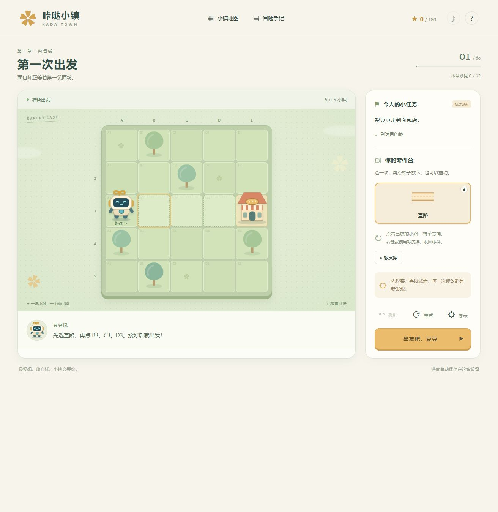

# 咔哒小镇 · Kada Town

[](https://github.com/fwzhuang/kada-town/actions/workflows/pages.yml)
[](LICENSE)
[](https://fwzhuang.github.io/kada-town/)

**用一块块小路，唤醒一座小镇。**

《咔哒小镇》是一款面向 6–12 岁儿童、也适合亲子共同游玩的二维机关路线解谜游戏。玩家摆放并旋转道路，为发条机器人「豆豆」设计路线，再启动运行、观察结果、修改方案。五个区域共有 **60 个主线关卡**，从接通第一条小路，逐步挑战按钮、小桥、钥匙、单向道路和传送机关。

**[在线试玩 →](https://fwzhuang.github.io/kada-town/)** · [反馈问题](https://github.com/fwzhuang/kada-town/issues) · [贡献指南](CONTRIBUTING.md)



## 项目特色

- **五章连贯剧情、60 关渐进挑战**：帮助面包师修好烤炉、为花园接通水车、送回迟到的信、恢复风车节，最后让钟楼重新报时。
- **观察与规划驱动**：没有倒计时、生命值或尝试次数限制；失败指出具体断口或缺少的条件，并保留道路布局。
- **道路与机关组合**：直路、弯路、固定道路、编号按钮与小桥、齿轮、钥匙与门、单向箭头、定向传送环。
- **轻量交互**：点击或拖放、90° 旋转、收回零件、最近 10 步撤销和分层提示。
- **本地进度**：按关解锁、三星挑战、自动存档、JSON 进度导出及合并导入。
- **零第三方运行依赖**：原生 HTML/CSS/JavaScript、独立 SVG 图层及浏览器合成音效；无需账号或后端服务。
- **适配桌面和平板**：手机也可游玩，复杂关卡建议使用横屏或较大的屏幕；尊重系统的减少动画偏好。

## 如何游玩

1. 观察豆豆的起点、目的地和机关位置，起点旁的箭头表示初始方向。
2. 在零件盒中选一块道路，再点击浅色空格放下；也可以将零件拖到格子上。
3. 点击已经放下的道路，顺时针旋转 90°，让相邻连接口接上。
4. 点击 **「出发吧，豆豆」**，观看豆豆按路线自动行动。
5. 遇到问题后修改道路，再次出发。运行途中可点击 **「停下来，修改」**。

右键点击道路，或先选择橡皮擦再点击道路，可以收回自己放下的零件。带小方块标记的固定道路和机关不能移动；盒子里剩余的零件可以不用。

| 操作 | 键盘或鼠标 |
| --- | --- |
| 选择零件、放置或旋转道路 | 点击；也可 `Tab` 定位后按 `Enter` |
| 收回道路 | 鼠标右键，或橡皮擦 |
| 撤销 | 撤销按钮，或 `Ctrl+Z` / `⌘Z` |
| 停止运行 | 停止按钮，或 `Escape` |
| 开关声音 | 顶部音符按钮，默认关闭 |

### 机关规则

| 机关 | 规则 |
| --- | --- |
| 按钮与小桥 | 先经过按钮，再通过同编号的小桥。不同编号独立控制。 |
| 齿轮 | 进入终点前必须收齐任务要求的所有齿轮。 |
| 钥匙与门 | 先拾取钥匙，才能通过同编号的门。钥匙不消耗。 |
| 单向箭头 | 必须沿箭头所指方向进入该格子。 |
| 传送环 | 从标有「入」的入口到达同编号「出」的出口，再沿出口固定道路继续前进。 |

关卡中的桥、门、箭头和传送环都是必经任务点。每次开始运行，按钮、桥和物品都会恢复初始状态；玩家摆好的道路保留。

### 星星与提示

- **一星**：完成任务，解锁下一关。
- **二星**：使用的道路数量达到关卡挑战目标。
- **三星**：第 8 关起要求一次运行成功；前 7 关给予探索星，鼓励熟悉操作。

通关后可以回到地图重新挑战，已经获得的星星只会增加。失败两次后可查看一级提示；失败三次后可逐层查看机关关系和顺序建议。提示不会自动摆出完整答案。

## 章节与难度

| 章节 | 关卡 | 剧情目标 | 主要规则 |
| --- | --- | --- | --- |
| 面包街 | 1–12 | 修好烤炉，让面包街重新营业 | 摆放、旋转、缺口、多余零件、按钮、小桥、齿轮 |
| 河边公园 | 13–24 | 唤醒水车、喷泉和花园 | 多组编号按钮与小桥、跨区域顺序规划 |
| 邮局街 | 25–36 | 送回迟到的信和问候 | 单组及双组钥匙与门、桥梁和必经物品 |
| 风车农场 | 37–48 | 修好磨坊，迎接风车节 | 单向道路、多齿轮、多条件组合 |
| 钟楼广场 | 49–60 | 修复大钟，让小镇重新运转 | 定向传送和综合机关链 |

棋盘从 5×5 扩展至 8×8。每章先引入规则，再组合机关，后期减少多余零件。前 12 关依据设计文档逐关实现；后 48 关由 12 种路线和方向模板搭配不同机关配置构成，具有独立关名与故事。实际儿童体验与难度仍可通过试玩继续调整。

## 本地运行

### 直接打开

[下载源码 ZIP](https://github.com/fwzhuang/kada-town/archive/refs/heads/main.zip)，解压后用现代浏览器打开 `index.html`。游戏本体无需安装 Node.js 或任何依赖。

### 本地服务器

开发与测试需要 **Node.js 22 或更新版本**。克隆仓库后执行：

```bash
git clone https://github.com/fwzhuang/kada-town.git
cd kada-town
node scripts/serve.js
```

浏览器访问 <http://127.0.0.1:4173/>。本项目没有 npm 依赖，无需执行 `npm install`。

### 检查与构建

```bash
# 验证所有关卡和规则
node --test tests/*.test.js

# 生成 GitHub Pages 部署目录
node scripts/build.js
```

也可使用 `npm start`、`npm test` 和 `npm run build`。构建产物在 `_site/`，只包含游戏 HTML、CSS、JavaScript、404 页面和 `.nojekyll`。

本地开发时，<http://127.0.0.1:4173/?preview=60> 可以直接预览指定关卡，使用独立测试存档。`preview` 参数仅在 `127.0.0.1` 生效，线上主线仍按顺序解锁。

## 存档与隐私

进度保存在当前浏览器的 `localStorage` 中。游戏代码不上传玩家进度，不包含账号、广告或第三方统计。GitHub Pages 托管层的数据处理由 GitHub 的服务政策决定。

- 不同浏览器、设备以及文件模式、localhost、GitHub Pages 的存档互相独立。
- 换设备或清理浏览器前，可在 **玩法说明 → 导出进度备份** 保存 JSON 文件。
- 导入备份时会合并两份存档，保留每关较高的星级。
- 浏览器禁用存储时仍可游玩，但需要手动导出备份。
- 「重新开始旅程」需要在游戏内再次确认；请先备份需要保留的进度。

## GitHub Pages 部署

本仓库通过 [GitHub Actions 工作流](.github/workflows/pages.yml) 自动测试和部署，遵循 [GitHub Pages 官方工作流说明](https://docs.github.com/en/pages/getting-started-with-github-pages/using-custom-workflows-with-github-pages)。

部署流程为：**提交到 `main` → 运行测试 → 生成 `_site/` → 上传静态产物 → 发布 Pages**。Pull Request 只运行测试和构建；合并到 `main` 后才部署。

如果 Fork 到自己的账号：

1. 在仓库 **Settings → Pages → Build and deployment → Source** 中选择 **GitHub Actions**。
2. 在 **Actions** 中启用工作流，提交一次修改，或手动运行 **Test and deploy**。
3. 打开部署记录中的地址。项目站点通常为 `https://你的用户名.github.io/仓库名/`。
4. 将 README 的试玩链接、状态徽章及 `package.json` 的仓库地址改为自己的地址。

所有游戏资源均使用相对路径，兼容项目站点的子目录。工作流使用平台提供的 `GITHUB_TOKEN`，无需额外配置个人访问令牌。

## 项目结构

```text
.
├── index.html                 # 游戏入口
├── styles.css                 # 布局、响应式适配与动画
├── 404.html                   # Pages 未找到页面
├── src/
│   ├── engine.js              # 纯规则引擎和存档校验
│   ├── levels.js              # 5 章剧情、60 关数据和标准解
│   ├── art.js                 # 道路、机器人、建筑及机关 SVG
│   └── app.js                 # 交互、地图、提示、声音及存档
├── scripts/
│   ├── serve.js               # 本地静态服务器
│   └── build.js               # 生成部署产物
├── tests/                     # 关卡、规则和构建检查
├── screenshots/               # README 游戏预览
├── docs/                      # 关卡设计与实现说明
├── .github/workflows/pages.yml
├── CONTRIBUTING.md
└── LICENSE
```

## 测试与扩展

规则测试覆盖全部 60 关标准解、道路连接口、零件预算、断路、方向错误、桥、齿轮、钥匙、单向路、传送、循环、必经点、星级和异常存档。构建测试验证子目录资源路径与发布文件清单。

新增关卡时可参考 `src/levels.js` 的 `make()` 工厂与 `tests/engine.test.js`，让标准解、可铺格子、机关顺序和零件数一起通过验证。扩展超过 60 关时，还需同步界面总关数、存档上限和章节解锁逻辑。更多实现约定见 [关卡设计说明](docs/level-design.md)。

当前为可直接游玩的浏览器版本，视觉采用程序生成的 SVG；没有原生安装包、配音或可视化关卡编辑器。欢迎通过 Issue 和 Pull Request 改进美术、无障碍操作、关卡节奏与剧情。

## 贡献与许可

欢迎反馈无法通关的布局、设备兼容问题或儿童试玩观察。提交前请阅读 [CONTRIBUTING.md](CONTRIBUTING.md)，并运行测试。

本仓库代码、SVG 视觉实现、剧情文字及游戏截图采用 **[MIT License](LICENSE)**。Copyright © 2026 [fwzhuang](https://github.com/fwzhuang)。本地原始设计文档和历史压缩包不属于本仓库发布内容。
